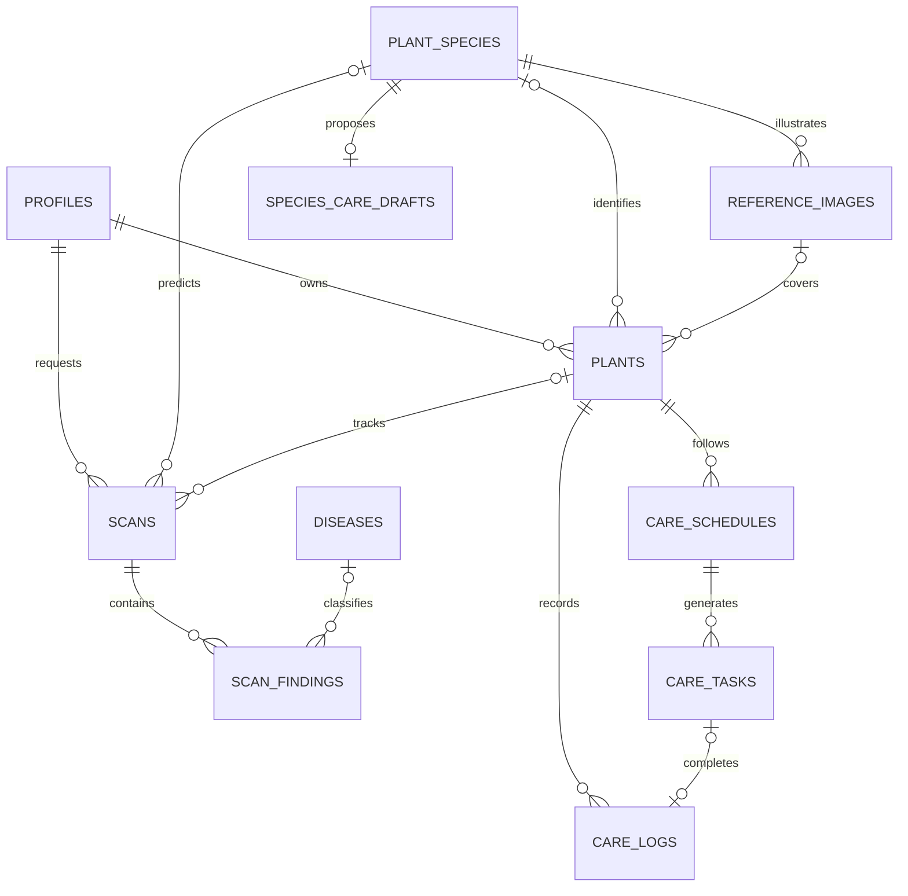

# Database AI Plant Care

PostgreSQL 16+ cho Flutter → Express (Node.js) → PostgreSQL. Đây là thiết kế cho bản demo Android của nhóm. Mười hai bảng nằm trong schema riêng `plantcare`. Mỗi chậu cây có danh tính, lịch chăm sóc và lịch sử riêng, kể cả khi nhiều chậu thuộc cùng loài.

## Sơ đồ

## Các màn hình đọc và ghi gì?

| Màn hình | Nguồn dữ liệu và hành vi |
| --- | --- |
| Đăng ký, đăng nhập, quên mật khẩu, Google | Thiết kế giả định dùng dịch vụ Auth cấp UUID. Auth quản lý email, mật khẩu, xác nhận và khôi phục. Express xác minh access token rồi upsert profile theo UUID. Dark Mode có thể lưu trong cài đặt thiết bị. |
| Hồ sơ | Tên, avatar, múi giờ trong profiles. Email lấy từ Auth. Đếm số cây trong plants và số lần phân tích có kết quả trong scans theo owner. |
| Vườn và việc hôm nay | Lọc plants theo owner. Hiện ảnh bìa, biệt danh và loài. Trạng thái sức khỏe lấy từ lần khám mới nhất có đánh giá sức khỏe. Khi chỉ có kết quả chưa rõ thì hiển thị “Chưa xác định”. Lọc care_tasks đang chờ thuộc lịch đang bật bằng khoảng từ đầu ngày đến đầu ngày kế trong múi giờ người dùng; việc quá hạn hiển thị riêng. |
| Quét và kết quả | scans có loại quét, ảnh, nguồn, thời điểm, cờ demo, loài dự đoán, độ tin cậy và trạng thái sức khỏe. scan_findings giữ thứ tự các nhãn bệnh, xác suất riêng, triệu chứng, nguyên nhân có thể, các bước chăm sóc và nguồn hướng dẫn. Mỗi chỉ số trong [0,1] hoặc NULL nếu nhà cung cấp không trả. |
| Chi tiết cây | plants + plant_species cho thông tin cây và hướng dẫn chung; hai lịch water/fertilize có chu kỳ và giờ riêng. Nhật ký gộp scans và care_logs theo thời điểm. So sánh tiến triển bằng hai lần quét thực sự thuộc cùng chậu; gắn nhãn rõ các bản demo. |

## Ba thao tác cần đúng ngay cả khi mất mạng

1. **Quét và lưu cây.** Flutter tạo một request_id mới cho mỗi thao tác, giữ nguyên khi gửi lại. Express lấy owner từ token; trước khi gọi AI, tra kết quả đã có bằng (owner_id, request_id). Hỏi AI và upload ảnh bên ngoài giao dịch database. Trong một transaction, tạo cây nếu nhận diện thành công một cây mới, thêm lần quét, các dự đoán, lịch và việc đầu tiên khi có hướng dẫn chăm sóc thích hợp. Nếu request trùng trong lúc chạy song song, rollback toàn bộ transaction thua rồi đọc bản đã lưu. So khớp cây, ảnh và chế độ trước khi trả lại kết quả cho request trùng. Khóa unique tránh bản ghi trùng trong DB; nếu cần chống gọi API tính phí hai lần đồng thời, backend cần giữ chỗ request trước khi gọi dịch vụ. Ảnh kém rõ được lưu là unknown hoặc cho chụp lại, không tự tạo cây mới. Khi quét từ chi tiết cây, dùng plant_id cũ và kiểm tra owner; một dự đoán khác loài không tự ghi đè loài người dùng đã lưu.
2. **Sinh lịch và đổi lịch do thời tiết.** care_schedules chứa quy tắc lặp; care_tasks chứa từng lần đến hạn. Khi sinh việc, unique(schedule_id, original_due_at) chống sinh trùng. Lấy dữ liệu thời tiết theo khu vực người dùng chọn và chỉ điều chỉnh khi phù hợp với môi trường trồng. Khi dời một việc, giữ nguyên original_due_at, cập nhật due_at, adjustment_reason và weather_snapshot. Ví dụ snapshot gồm source, fetched_at, forecast_date, precipitation_mm và is_mock. Nếu API lỗi, giữ hạn hiện tại. Kiểm tra múi giờ IANA tại backend, lưu thời điểm tuyệt đối bằng timestamptz, lấy giờ nhắc theo local_time và profiles.timezone. Khi đổi giờ/tắt lịch, cập nhật hoặc bỏ qua các việc đang chờ tương ứng và đặt lại/hủy thông báo trên thiết bị.
3. **Đánh dấu đã tưới.** Trong một transaction, khóa dòng việc bằng SELECT ... FOR UPDATE, kiểm tra owner, trạng thái và lịch. Nếu pending thì tạo care_log liên kết task, đổi state sang done và sinh việc tiếp theo đúng một lần. Nếu đã done thì trả lại log cũ. UNIQUE(task_id) bảo vệ khi người dùng chạm hai lần; khóa ngoại ghép bảo vệ cây và loại việc cả khi chỉnh dữ liệu. Ghi chú, chữa bệnh, tưới ngoài lịch có task_id NULL. Quy ước MVP là chu kỳ tiếp theo tính từ ngày thực hiện, theo giờ địa phương đã chọn.

## Ảnh, quyền truy cập và thông báo

- Database lưu object key, ví dụ owner-uuid/scan-uuid/leaf.jpg. Ảnh đặt trong bucket private. Express xác minh tài khoản sở hữu ảnh trước khi cấp URL xem ảnh có thời hạn. Khi xóa cây, quan hệ cascade xóa dữ liệu con; backend dọn object tương ứng sau commit, có thể thử lại nếu storage lỗi.
- Schema chỉ dành cho backend. Dùng role runtime riêng với USAGE trên schema và SELECT/INSERT/UPDATE/DELETE trên bảng cần thiết. Dùng role migration để tạo bảng; không cấp quyền schema cho PUBLIC hoặc client mobile. Nếu dùng Supabase, giữ plantcare ngoài danh sách schema của Data API. Mọi truy vấn cá nhân cần lọc theo chủ đã xác minh, kể cả truy vấn bằng task_id hoặc scan_id. FK chỉ đảm bảo liên kết dữ liệu, quyền đọc/sửa do API kiểm tra.
- Đã có bảng `notifications` và worker tạo hộp thư nhắc đến hạn trong backend. Xem [lịch thông minh](../../docs/BACKEND_FEATURES_1_2_5.md). **Push điện thoại vẫn chưa tích hợp**. Phương án nhắc cục bộ là lựa chọn ở Flutter: Flutter đặt thông báo từ care_tasks và dùng task_id để nhận diện khi đặt lại/hủy. Nếu nhóm cam kết **push từ server tới nhiều thiết bị**, cần bổ sung bảng thiết bị (owner_id, token, platform, revoked_at) và bảng giao thông báo (task_id, device_id, planned_at, status, sent_at, unique cho mỗi lần gửi), kèm tiến trình gửi. PostgreSQL tự nó không phát thông báo Android.
- Xem vườn offline là mở rộng ở Flutter: cache theo người dùng trên máy, xóa cache khi đổi tài khoản. Các request viết lại dùng cùng request_id. API key của AI/thời tiết và DATABASE_URL chỉ ở backend. Không lưu key trong lịch sử quét.

## Cách áp dụng

Gemini lưu bản đề xuất trong `species_care_drafts`; dữ liệu chính nằm trong `plant_species` cùng trạng thái và thông tin duyệt. Planner chỉ khởi tạo lịch từ loài `care_status=verified`. Giá trị cũ không tự được coi là đã duyệt. Xem [hợp đồng dữ liệu chăm sóc](../../docs/CARE_DATA_AI.md).

Làm theo [hướng dẫn backend](../README.md). `npm run db:migrate` áp các migration có theo dõi trong `prisma/migrations/`; `npm run db:status` xem trạng thái. Schema ORM đã đồng bộ trong `prisma/schema.prisma`. PostgreSQL thực thi CHECK, khóa ngoại và index từ SQL migrations.

Bảng reference_images lưu loài, nhà cung cấp, ID ảnh của nguồn, URL ảnh/thumbnail, attribution, URL nguồn và giấy phép. plants.reference_image_id liên kết ảnh bìa tham khảo với đúng loài cây, còn plants.cover_image_key dành cho ảnh upload riêng. Một cây chọn một nguồn bìa tại một thời điểm. scans.image_key luôn giữ ảnh thực sự dùng ở lần phân tích. API đọc chi tiết cây trả metadata để Flutter ghi nguồn ảnh theo giấy phép. Nhập ảnh vào danh mục qua backend sau khi xác minh nguồn và quyền sử dụng.

File 002_supabase_auth_optional.sql chỉ áp khi chọn Supabase Auth và mọi profile đã có UUID tương ứng trong auth.users. Xem thêm cách cấu hình role và môi trường trong README backend.

## Nghiệm thu theo rubric

- **Chức năng:** lưu một lần quét mới rồi quét lại từ chi tiết. Có một chậu, hai kết quả, hai mốc thời gian. Tạo thêm chậu cùng loài ở môi trường khác, đổi lịch vì mưa đúng chậu ngoài trời.
- **Dữ liệu và lỗi:** tắt mạng sau khi máy chủ đã commit, gửi lại cùng ID, kiểm tra số cây/lần quét/log. Thử AI trả dữ liệu thiếu; chỉ tạo lịch khi có chu kỳ hợp lệ. Test tắt/bật lịch, dữ liệu rỗng và ngày đổi theo múi giờ.
- **Bảo mật:** đăng nhập A và B; B thử xem, sửa, xóa cây hoặc mở ảnh của A đều phải bị API từ chối. Kiểm tra cả nhật ký và việc đến hạn.
- **AI và demo:** chạy cả luồng mẫu khi không có key; màn hình kết quả và lịch sử đều hiện nhãn giả lập. Thử phân biệt ảnh cây khỏe, có bệnh nghi ngờ và ảnh chưa nhận diện được.
- Các test tích hợp DB bổ sung cho bộ test Flutter. Mức Xuất sắc của tiêu chí kiểm thử trong PDF yêu cầu từ 15 test có ý nghĩa với unit test logic chính và ít nhất 2 widget test. Schema cung cấp dữ liệu cho demo trên máy Android thật; điểm còn phụ thuộc ứng dụng, kiểm thử, README và vấn đáp.

Tham khảo [ràng buộc PostgreSQL](https://www.postgresql.org/docs/16/ddl-constraints.html) và [liên kết hồ sơ Supabase Auth](https://supabase.com/docs/guides/auth/managing-user-data).
