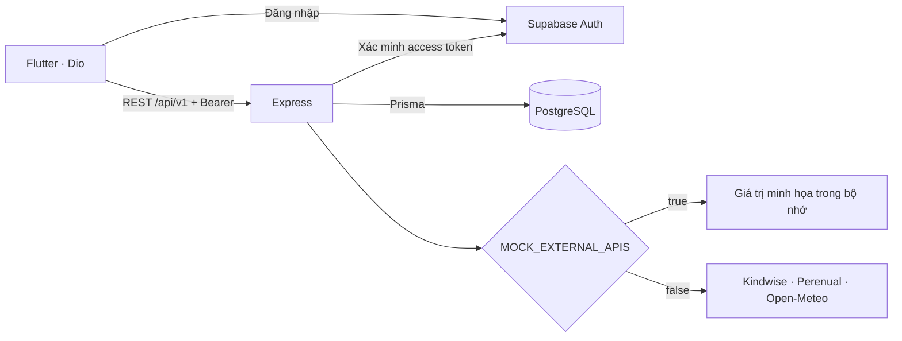

# Kiến trúc Phase 1

Flutter lấy session từ Supabase SDK. Interceptor Dio đính kèm token vào request. Middleware hỏi `/auth/v1/user` bằng token đó và publishable key. ID trong kết quả đã xác minh dùng cho mọi truy vấn dữ liệu cá nhân. API tạo profile khi người dùng thêm cây đầu tiên. Development bypass dùng một UUID cố định và chỉ hoạt động trong development. Bật bypass ở môi trường khác làm server từ chối khởi động.

Scan nhận multipart, giới hạn 5 MiB, so MIME và chữ ký JPEG/PNG. Backend nhận diện loài trước rồi lấy nhãn bệnh và thông tin chăm sóc. Adapter Perenual khớp tên khoa học trước khi đọc chi tiết. Khi nhà cung cấp lỗi, API báo lỗi. Mode mock dùng bốn implementation cục bộ và trả `isMock: true`. Weather dùng tọa độ của request và ngày địa phương do Open-Meteo trả.

Frontend đặt các file Dart trực tiếp trong `lib/`. Backend gom mã theo bốn thư mục trong `src/`: `routes/` xử lý endpoint, `services/` gọi nhà cung cấp, `config/` cấu hình ứng dụng và database, `middlewares/` xử lý xác thực và lỗi. Schema và migration nằm trong `backend/prisma/`.

Supabase Storage dành cho ảnh được lưu sau này. Schema giữ object key. Khi triển khai chức năng lưu, tạo bucket private, kiểm tra ownership theo user ID và dùng signed URL khi xem ảnh.

Hợp đồng nhà cung cấp: [Kindwise OpenAPI](https://plant.id/api/v3/openapi.yaml), [Perenual v2](https://perenual.com/docs/api), [Open-Meteo Forecast](https://open-meteo.com/en/docs), [Supabase Auth](https://supabase.com/docs/reference/javascript/auth-getuser).
