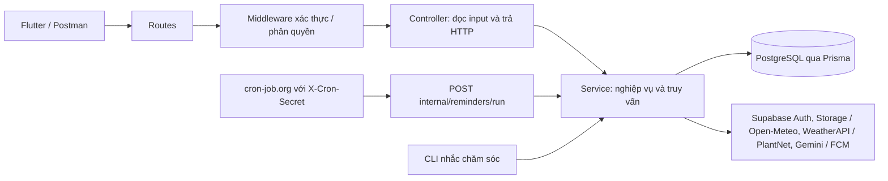

# Cấu trúc backend

Backend Express dùng kiến trúc phân lớp Routes → Controller → Service → Database. Đây không phải MVP (Model–View–Presenter) của giao diện. Frontend Flutter độc lập và giao tiếp qua HTTP API.

## Trách nhiệm từng thư mục

| Thư mục | Trách nhiệm |
| --- | --- |
| `src/routes/` | Khai báo method, URL, middleware và controller; `index.ts` ghép các nhóm API. Query DB và nghiệp vụ đặt trong service; route có thể gắn middleware kiểm tra secret. |
| `src/controllers/` | Đọc và kiểm tra params/query/body, lấy người dùng đã xác thực, gọi service, trả status/JSON. Không truy vấn DB hoặc tính toán nghiệp vụ. |
| `src/services/` | Truy vấn Prisma, transaction, lọc dữ liệu theo chủ sở hữu, tính thống kê, lập lịch và gọi API ngoài. Không nhận Express `req`/`res`. |
| `src/middlewares/` | Xác thực, kiểm tra quyền duyệt, header bảo mật và xử lý lỗi. |
| `src/config/` | Đọc cấu hình, khởi tạo Prisma Client và connection pool. |
| `src/jobs/` | Khởi chạy worker, hẹn lượt chạy, nhận tín hiệu dừng và ghi log. Gọi service để xử lý dữ liệu. |
| `src/views/` | Chỉ chứa HTML trang kiểm thử callback Auth có sẵn, phục vụ trong development. |
| `prisma/` | Mô hình dữ liệu và migration. |

Controller nhận `db` qua hàm khởi tạo để tạo service; việc truyền dependency này không phải truy vấn DB. Các lệnh `db.$connect()` / `db.$disconnect()` ở `server.ts` và job quản lý vòng đời kết nối. Script seed/migration và test có thể thao tác DB trực tiếp vì không phải luồng xử lý API.

## Theo chức năng

| Chức năng | Route | Controller | Service |
| --- | --- | --- | --- |
| Đăng nhập, đăng ký, Google, khôi phục, đăng xuất | `auth.ts` | `auth.ts` | `auth.ts` (Supabase Auth) |
| Hồ sơ, thống kê chăm sóc | `profile.ts` | `profile.ts` | `profile.ts` |
| Xem cây trong vườn | `garden.ts` | `garden.ts` | `garden.ts` |
| Đồng bộ lịch, danh sách việc | `care-plan.ts` | `care-plan.ts` | `care-planner.ts`, `care-tasks.ts` |
| Cấu hình lịch chăm sóc | `schedules.ts` | `schedules.ts` | `schedules.ts` |
| Dữ liệu chăm sóc từ AI, duyệt dữ liệu | `care-data.ts` | `care-data.ts` | `care-data.ts`, `gemini-care.ts` |
| Lịch sử thông báo | `notifications.ts` | `notifications.ts` | `notifications.ts` |
| Kiểm tra tiến trình và DB | `health.ts` | `health.ts` | `health.ts` |
| Nhắc chăm sóc nền | `internal-reminders.ts`; CLI `jobs/reminders.ts` | `internal-reminders.ts` | `scheduled-reminders.ts`, `reminders.ts`, `care-planner.ts`, `push-notifications.ts` |
| Quét ảnh | `scans.ts` | `scans.ts` | `scans.ts` |
| Nhật ký | `care-logs.ts` | `care-logs.ts` | `care-logs.ts` |

Ví dụ `GET /api/v1/me/stats`: route gắn `controller.stats` → controller lấy user ID đã xác thực → `profileService.stats(userId)` đếm cây, lượt quét và nhật ký chăm sóc trong DB → controller trả JSON theo định dạng chung.

Khi thêm chức năng, đặt các điều kiện nghiệp vụ và kiểm tra chủ sở hữu trong service để cả API lẫn job dùng lại được. Giữ URL, body, response và mã lỗi hiện có khi chỉ tái cấu trúc.
