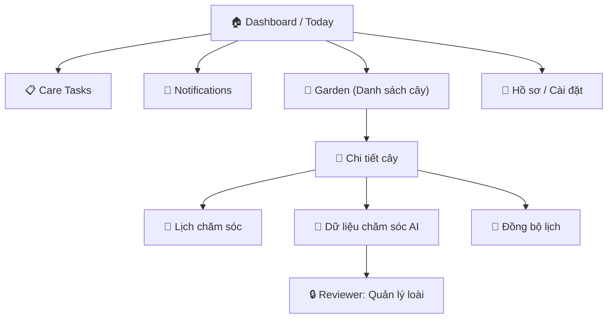
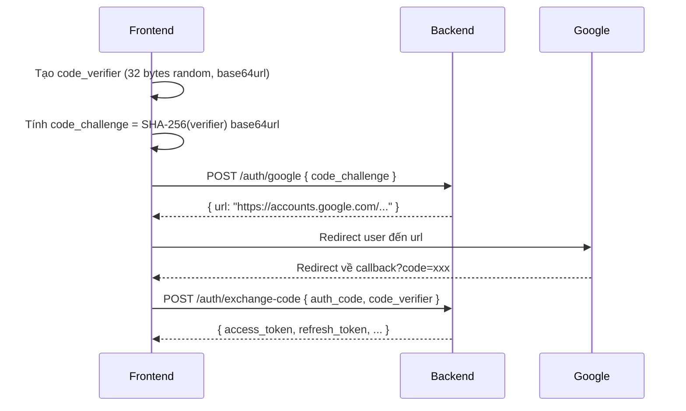

# 📋 Tài liệu Frontend – AI Plant Care

> [!NOTE]
> Tài liệu này liệt kê **API hồ sơ, vườn và chăm sóc**; Auth xem [AUTH_SETUP](AUTH_SETUP.md), quét ảnh/nhật ký xem routes và tài liệu chức năng tương ứng, mô tả chi tiết **màn hình frontend cần thiết** và **API tương ứng** cho từng chức năng.

**Base URL**: local `http://localhost:3100/api/v1`; bản triển khai `https://ai-plant-care.onrender.com/api/v1`
**Auth**: API nghiệp vụ yêu cầu `Authorization: Bearer <access_token>`. `/health`, `/ready` và Auth đăng ký/login/refresh/forgot/resend/google/exchange công khai; reset-password và logout cần token thật. `/internal/reminders/run` dùng `X-Cron-Secret`, không dùng token người dùng.

---

## 1. Hồ sơ người dùng (Profile)

### Mô tả
Xem và cập nhật thông tin cá nhân (tên hiển thị, timezone). Hiển thị thống kê tổng quan (số cây, số lần quét AI).

### Màn hình: **Trang Hồ Sơ / Cài Đặt**

| Thành phần UI | Mô tả |
|---|---|
| Avatar | Hiển thị ảnh đại diện (`avatar_url` từ Google/Supabase) |
| Tên hiển thị | Hiển thị `display_name`, cho phép chỉnh sửa |
| Email | Hiển thị `email` (read-only) |
| Timezone | Dropdown chọn timezone (ví dụ: `Asia/Ho_Chi_Minh`) |
| Thống kê | Hiển thị `total_plants` (tổng số cây) và `total_ai_scans` (tổng lần quét AI) |
| Nút Lưu | Gọi API cập nhật khi thay đổi |

### API sử dụng

| Method | Endpoint | Mô tả | Request Body | Response |
|---|---|---|---|---|
| `GET` | `/me` | Lấy hồ sơ hiện tại | — | `{ id, display_name, avatar_key, timezone, created_at, email, avatar_url, total_plants, total_ai_scans, isDemo }` |
| `PATCH` | `/me` | Cập nhật hồ sơ | `{ display_name?: string, timezone?: string }` (ít nhất 1 trường) | `{ id, display_name, avatar_key, timezone, created_at, isDemo }` |

---

## 2. Vườn cây (Garden / My Plants)

### Mô tả
Danh sách tất cả cây của người dùng, xem chi tiết từng cây (thông tin loài, ảnh tham khảo).

### Màn hình 2a: **Danh sách cây (Garden List)**

| Thành phần UI | Mô tả |
|---|---|
| Danh sách dạng grid/list | Mỗi cây hiển thị: `nickname`, `cover_image_key`, `environment`, `region_name` |
| Danh sách | Hiện trả toàn bộ cây của người dùng; chưa hỗ trợ offset/limit |
| Trạng thái trống | Hiển thị thông báo khi chưa có cây nào |

### Màn hình 2b: **Chi tiết cây (Plant Detail)**

| Thành phần UI | Mô tả |
|---|---|
| Ảnh chính | Hiển thị `cover_image_url` (URL ký có thời hạn), không dùng object key làm URL; hoặc ảnh tham khảo từ `referenceImage` |
| Tên cây | `nickname` |
| Thông tin loài | `species.scientific_name`, `species.common_name` |
| Môi trường | `environment` ("indoor", "outdoor", "unknown") |
| Vị trí | `region_name`, `latitude`, `longitude` |
| Ảnh tham khảo | `referenceImage.image_url`, `referenceImage.attribution`, `referenceImage.source_url` |
| Hướng dẫn chăm sóc loài | Nếu `species.care_status` là `verified` hoặc `ai_suggested`: hiển thị `water_guide`, `light_guide`, `soil_guide`, `temperature_guide`, `fertilizer_guide`, `watering_days`, `fertilizing_days` |
| Nút hành động | Link đến: Lịch chăm sóc, Dữ liệu chăm sóc AI, Đồng bộ lịch |

### API sử dụng

| Method | Endpoint | Mô tả | Query Params | Response |
|---|---|---|---|---|
| `GET` | `/garden` | Danh sách cây | Không có phân trang | Mảng plant objects |
| `GET` | `/garden/:id` | Chi tiết 1 cây | — | `{ ...plant, species, referenceImage }` |

### Cấu trúc dữ liệu Plant

```json
{
  "id": "uuid",
  "owner_id": "uuid",
  "species_id": "uuid | null",
  "nickname": "string",
  "cover_image_key": "string | null",
  "environment": "indoor | outdoor | unknown",
  "region_name": "string | null",
  "latitude": "number | null",
  "longitude": "number | null",
  "created_at": "ISO datetime",
  "reference_image_id": "uuid | null"
}
```

---

## 3. Dữ liệu chăm sóc AI (Care Data)

### Mô tả
Gemini thật có thể bổ sung dữ liệu với trạng thái `ai_suggested` để lập lịch ngay khi có chu kỳ hợp lệ. Dữ liệu demo không được dùng làm lịch thật; chu kỳ null không tự suy đoán. Reviewer có thể duyệt/từ chối đề xuất. Xem [CARE_DATA_AI](CARE_DATA_AI.md) để phân biệt dữ liệu AI và dữ liệu đã duyệt.

### Màn hình 3a: **Dữ liệu chăm sóc của cây (Plant Care Data)**

| Thành phần UI | Mô tả |
|---|---|
| Thông tin loài | `species.scientific_name`, `species.common_name` |
| Trạng thái dữ liệu | `species.care_status`: `"missing"` / `"draft"` / `"ai_suggested"` / `"verified"` |
| Hướng dẫn chăm sóc (verified hoặc ai_suggested, hiển thị nguồn) | `species.water_guide`, `light_guide`, `soil_guide`, `temperature_guide`, `fertilizer_guide` |
| Chu kỳ | `species.watering_days` ngày/lần tưới, `species.fertilizing_days` ngày/lần bón |
| Bản đề xuất AI (nếu có draft) | Hiển thị `draft.data` (care proposal), `draft.status`, `draft.provider`, `draft.model`, `draft.is_mock` |
| Nút "Bổ sung dữ liệu AI" | Gọi API enrich nếu chưa có hoặc muốn tạo lại |
| Loading state | Khi `draft.status === "generating"`, hiển thị spinner/progress |

### Màn hình 3b: **Quản lý dữ liệu loài – Reviewer Only** ⚠️

> [!IMPORTANT]
> Chỉ tài khoản có ID nằm trong `CARE_REVIEWER_IDS` mới truy cập được các API species. Frontend cần ẩn/hiện UI reviewer dựa trên response lỗi 403 hoặc một flag từ server.

| Thành phần UI | Mô tả |
|---|---|
| Xem dữ liệu loài | Hiển thị toàn bộ care data + draft details (bao gồm `source_documents`, `review_note`, `reviewed_by`) |
| Nút "Tạo đề xuất AI" | Gọi enrich species, có thể gửi kèm `sources` (tài liệu tham khảo) |
| Form tài liệu nguồn | Nhập mảng `sources`: `[{ title, url (https), excerpt }]` (tối đa 5) |
| Nút "Duyệt" (approve) | Gửi `action: "approve"`, `generation_id`, `note`, tuỳ chọn chỉnh sửa `care` data trước khi duyệt |
| Nút "Từ chối" (reject) | Gửi `action: "reject"`, `generation_id`, `note` |
| Form chỉnh sửa care data | Cho phép sửa: `watering_days`, `fertilizing_days`, `water_guide`, `light_guide`, `soil_guide`, `temperature_guide`, `fertilizer_guide` trước khi approve |

### API sử dụng

| Method | Endpoint | Mô tả | Request Body | Response |
|---|---|---|---|---|
| `GET` | `/plants/:id/care-data` | Dữ liệu chăm sóc theo cây | — | `{ species, draft }` |
| `POST` | `/plants/:id/care-data/enrich` | Yêu cầu AI bổ sung dữ liệu | `{}` | `{ species, draft, cached? }` (202 nếu đang generating) |
| `GET` | `/species/:id/care-data` | 🔒 Reviewer: xem dữ liệu loài | — | `{ species, care_reviewed_by, draft (chi tiết đầy đủ) }` |
| `POST` | `/species/:id/care-data/enrich` | 🔒 Reviewer: tạo đề xuất AI cho loài | `{ force?: boolean, sources?: [{ title, url, excerpt }] }` | `{ species, draft, cached? }` |
| `PATCH` | `/species/:id/care-data/review` | 🔒 Reviewer: duyệt/từ chối đề xuất | Xem chi tiết bên dưới | `{ species, care_reviewed_by, draft }` |

#### Body cho review (PATCH):

````carousel
**Approve (duyệt):**
```json
{
  "action": "approve",
  "generation_id": "uuid của draft",
  "note": "Ghi chú duyệt (bắt buộc, 1-2000 ký tự)",
  "care": {
    "watering_days": 7,
    "fertilizing_days": 30,
    "water_guide": "Hướng dẫn tưới...",
    "light_guide": "Hướng dẫn ánh sáng...",
    "soil_guide": "Hướng dẫn đất...",
    "temperature_guide": "Hướng dẫn nhiệt...",
    "fertilizer_guide": "Hướng dẫn bón phân..."
  }
}
```
<!-- slide -->
**Reject (từ chối):**
```json
{
  "action": "reject",
  "generation_id": "uuid của draft",
  "note": "Lý do từ chối (bắt buộc, 1-2000 ký tự)"
}
```
````

### Cấu trúc care data fields

```json
{
  "watering_days": "number 1-365 | null",
  "fertilizing_days": "number 1-365 | null",
  "water_guide": "string ≤3000 | null",
  "light_guide": "string ≤3000 | null",
  "soil_guide": "string ≤3000 | null",
  "temperature_guide": "string ≤3000 | null",
  "fertilizer_guide": "string ≤3000 | null"
}
```

---

## 4. Lịch chăm sóc (Care Schedules)

### Mô tả
Mỗi cây có thể có lịch **tưới nước (water)** và **bón phân (fertilize)**. Người dùng xem và chỉnh sửa tần suất, giờ nhắc, bật/tắt.

### Màn hình: **Cài đặt lịch chăm sóc (Plant Schedules)**

| Thành phần UI | Mô tả |
|---|---|
| Timezone | Hiển thị `timezone` của người dùng |
| Card lịch tưới nước | `kind: "water"` – hiển thị `interval_days`, `local_time`, `enabled` |
| Card lịch bón phân | `kind: "fertilize"` – hiển thị `interval_days`, `local_time`, `enabled` |
| Form chỉnh sửa | Cho phép sửa: tần suất (1-365 ngày), giờ nhắc (HH:mm), bật/tắt |
| Nút Lưu | Gọi API save cho từng loại |

### API sử dụng

| Method | Endpoint | Mô tả | Request Body | Response |
|---|---|---|---|---|
| `GET` | `/plants/:id/schedules` | Danh sách lịch của cây | — | `{ timezone, items: [...schedule] }` |
| `PUT` | `/plants/:id/schedules/:kind` | Lưu/cập nhật lịch | `{ interval_days: number, local_time: "HH:mm", enabled: boolean }` | Schedule object |

`:kind` là `"water"` hoặc `"fertilize"`

### Cấu trúc Schedule

```json
{
  "id": "uuid",
  "plant_id": "uuid",
  "kind": "water | fertilize",
  "interval_days": 7,
  "local_time": "08:00",
  "enabled": true,
  "starts_at": "ISO datetime"
}
```

---

## 5. Việc cần làm hôm nay (Care Tasks / Today)

### Mô tả
Danh sách các task chăm sóc theo ngày. Hệ thống tự tạo task dựa trên schedule + thời tiết. Hiển thị việc cần tưới/bón phân cho ngày được chọn.

### Màn hình: **Trang chính / Today Dashboard**

| Thành phần UI | Mô tả |
|---|---|
| Chọn ngày | Date picker, default là hôm nay |
| Tab trạng thái | `pending` (chờ làm) / `done` (đã xong) / `skipped` (bỏ qua) |
| Danh sách task | Mỗi task hiển thị: loại (`kind`), thời gian (`due_at`), lý do điều chỉnh thời tiết (`adjustment_reason`), thông tin cây (tên + ảnh) |
| Thông tin cây | `care_schedules.plants.nickname`, ảnh từ `cover_image_key` hoặc `reference_images` |
| Phân trang | `offset` + `limit` |

### API sử dụng

| Method | Endpoint | Mô tả | Query Params | Response |
|---|---|---|---|---|
| `GET` | `/care-tasks` | Danh sách task | `date` (YYYY-MM-DD, default hôm nay), `state` ("pending"/"done"/"skipped", default "pending"), `limit` (1-100, default 20), `offset` (default 0) | `{ date, timezone, items: [...task] }` |

### Cấu trúc Care Task

```json
{
  "id": "uuid",
  "schedule_id": "uuid",
  "plant_id": "uuid",
  "kind": "water | fertilize",
  "original_due_at": "ISO datetime",
  "due_at": "ISO datetime",
  "state": "pending | done | skipped",
  "adjustment_reason": "string | null (lý do dời lịch do thời tiết)",
  "weather_snapshot": "object | null",
  "care_schedules": {
    "plants": {
      "id": "uuid",
      "nickname": "string",
      "cover_image_key": "string | null",
      "reference_images": [{ "image_url": "...", "attribution": "...", "source_url": "..." }]
    }
  }
}
```

---

## 6. Đồng bộ lịch chăm sóc (Care Plan Sync)

### Mô tả
Trigger thủ công để hệ thống tính toán lại task chăm sóc cho 1 cây: tạo schedule từ care data loài (nếu chưa có), tính ngày due tiếp theo, điều chỉnh theo thời tiết (cây outdoor), tạo notification.

### Màn hình: Nút trong **Chi tiết cây** hoặc **Dashboard**

| Thành phần UI | Mô tả |
|---|---|
| Nút "Đồng bộ lịch" | Gọi API sync, hiển thị loading |
| Kết quả | Hiển thị `tasks` được cập nhật, `warnings`, `weather_source`, `notifications_created` |
| Cảnh báo | Hiển thị `warnings` array: `ENVIRONMENT_UNKNOWN_BASELINE_ONLY`, `LOCATION_REQUIRED_FOR_WEATHER`, `CARE_DATA_REVIEW_REQUIRED`, v.v. |

### API sử dụng

| Method | Endpoint | Mô tả | Request Body | Response |
|---|---|---|---|---|
| `POST` | `/plants/:id/care-plan/sync` | Đồng bộ lịch chăm sóc | `{}` | `{ plant_id, timezone, tasks: [...], notifications_created, warnings: [...], weather_source }` |

---

## 7. Thông báo (Notifications)

### Mô tả
Hệ thống tạo thông báo tự động khi đến lịch tưới/bón phân. Người dùng xem danh sách, đếm chưa đọc, đánh dấu đã đọc.

### Màn hình 7a: **Badge thông báo (Header)**

| Thành phần UI | Mô tả |
|---|---|
| Icon chuông + badge | Hiển thị `unread_count`. Polling định kỳ hoặc khi vào app |

### Màn hình 7b: **Danh sách thông báo (Notifications Page/Dropdown)**

| Thành phần UI | Mô tả |
|---|---|
| Danh sách thông báo | Mỗi item: `title`, `body`, `created_at`, `kind` (loại: water/fertilize), trạng thái đọc (`read_at`) |
| Filter | Toggle "Chỉ chưa đọc" (`unread=true`) |
| Phân trang cursor | Dùng `cursor` (base64url encoded) để tải thêm – **không dùng offset** |
| Đánh dấu đã đọc | Nhấn vào thông báo → gọi markRead |

### API sử dụng

| Method | Endpoint | Mô tả | Query Params | Response |
|---|---|---|---|---|
| `GET` | `/notifications` | Danh sách thông báo | `limit` (1-100, default 20), `unread` ("true"/"false", default "false"), `cursor` (optional) | `{ items: [...], next_cursor: string \| null }` |
| `GET` | `/notifications/unread-count` | Số thông báo chưa đọc | — | `{ unread_count: number }` |
| `PATCH` | `/notifications/:id/read` | Đánh dấu đã đọc | — | `{ id, read_at }` |

### Cấu trúc Notification

```json
{
  "id": "uuid",
  "kind": "water | fertilize",
  "title": "Đến lịch kiểm tra tưới nước",
  "body": "Cây X: kiểm tra độ ẩm đất trước khi tưới.",
  "created_at": "ISO datetime",
  "read_at": "ISO datetime | null"
}
```

> [!TIP]
> **Phân trang cursor**: Khi response trả `next_cursor !== null`, gửi `?cursor=<next_cursor>` để lấy trang tiếp. Khi `next_cursor === null` → hết dữ liệu.

---

## 🗺️ Tổng hợp sơ đồ màn hình



## 📊 Tổng hợp tất cả API (ngoài auth)

| # | Method | Endpoint | Chức năng | Màn hình |
|---|---|---|---|---|
| 1 | `GET` | `/me` | Lấy hồ sơ | Hồ sơ |
| 2 | `PATCH` | `/me` | Cập nhật hồ sơ | Hồ sơ |
| 3 | `GET` | `/garden` | Danh sách cây | Garden |
| 4 | `GET` | `/garden/:id` | Chi tiết cây | Chi tiết cây |
| 5 | `GET` | `/plants/:id/care-data` | Dữ liệu chăm sóc | Chi tiết cây / Care Data |
| 6 | `POST` | `/plants/:id/care-data/enrich` | AI bổ sung care data | Chi tiết cây / Care Data |
| 7 | `GET` | `/species/:id/care-data` | 🔒 Xem loài (reviewer) | Reviewer Panel |
| 8 | `POST` | `/species/:id/care-data/enrich` | 🔒 Tạo đề xuất AI loài | Reviewer Panel |
| 9 | `PATCH` | `/species/:id/care-data/review` | 🔒 Duyệt/từ chối | Reviewer Panel |
| 10 | `GET` | `/plants/:id/schedules` | Xem lịch cây | Lịch chăm sóc |
| 11 | `PUT` | `/plants/:id/schedules/:kind` | Cập nhật lịch | Lịch chăm sóc |
| 12 | `POST` | `/plants/:id/care-plan/sync` | Đồng bộ lịch | Chi tiết cây |
| 13 | `GET` | `/care-tasks` | Task hôm nay | Dashboard |
| 14 | `GET` | `/notifications` | Danh sách thông báo | Thông báo |
| 15 | `GET` | `/notifications/unread-count` | Đếm chưa đọc | Header badge |
| 16 | `PATCH` | `/notifications/:id/read` | Đánh dấu đã đọc | Thông báo |

---

## 8. Xác thực (Auth) – Luồng frontend cần xử lý

> [!NOTE]
> Phần này không phải "chức năng mới" nhưng frontend **bắt buộc** phải implement đúng để tất cả API trên hoạt động.

### API Auth đầy đủ

| # | Method | Endpoint | Mô tả | Request Body |
|---|---|---|---|---|
| A1 | `POST` | `/auth/register` | Đăng ký | `{ email, password (≥8), full_name }` |
| A2 | `POST` | `/auth/login` | Đăng nhập | `{ email, password }` |
| A3 | `POST` | `/auth/refresh` | Làm mới token | `{ refresh_token }` |
| A4 | `POST` | `/auth/forgot-password` | Quên mật khẩu | `{ email }` |
| A5 | `POST` | `/auth/resend-confirmation` | Gửi lại email xác nhận | `{ email }` |
| A6 | `POST` | `/auth/google` | Lấy URL Google OAuth | `{ code_challenge }` → trả `{ url }` |
| A7 | `POST` | `/auth/exchange-code` | Đổi mã Google lấy token | `{ auth_code, code_verifier }` |
| A8 | `POST` | `/auth/reset-password` | Đặt mật khẩu mới (cần Bearer token) | `{ password (≥8) }` |
| A9 | `POST` | `/auth/logout` | Đăng xuất (cần Bearer token) | — |

### Session response format

Các API trả session (login, register, refresh, exchange-code) đều có cấu trúc:

```json
{
  "access_token": "eyJ...",
  "refresh_token": "xxx...",
  "expires_in": 3600,
  "expires_at": 1700000000,
  "token_type": "bearer",
  "user": { "id": "uuid", "email": "...", "user_metadata": {...} }
}
```

### Luồng Google OAuth (PKCE)



### Token management (quan trọng)

- Lưu `access_token` và `refresh_token` an toàn (memory hoặc secure storage)
- Gắn header `Authorization: Bearer <access_token>` cho mọi API request
- Khi nhận **401**, gọi `POST /auth/refresh` → nếu thành công, retry request gốc
- Khi refresh cũng fail → redirect về login

---

## 9. Dữ liệu có trong DB nhưng CHƯA CÓ API

> [!IMPORTANT]
> Các bảng sau đã tồn tại trong database (do scan AI tạo ra) nhưng backend **chưa expose API CRUD**. Frontend hiện tại **chưa cần** build màn hình cho chúng, nhưng nên biết để chuẩn bị cho phase sau.

### 9a. Quét AI (Scans) – chưa có route

Bảng `scans` lưu kết quả quét ảnh cây bằng AI (nhận diện loài, đánh giá sức khỏe).

```
scans: id, owner_id, plant_id, image_key, mode, source, is_mock,
       scanned_at, species_id, reported_species_name, species_confidence,
       health_status
```

### 9b. Kết quả phát hiện bệnh (Scan Findings) – chưa có route

Bảng `scan_findings` lưu chi tiết các bệnh tìm được trong 1 lần quét.

```
scan_findings: scan_id, position, disease_id, reported_name, confidence,
              symptoms, possible_cause, treatment_steps[], guidance_source
```

### 9c. Danh mục bệnh (Diseases) – chưa có route

```
diseases: id, code, display_name
```

### 9d. Nhật ký chăm sóc (Care Logs) – chưa có route

Bảng `care_logs` lưu khi người dùng thực hiện hành động chăm sóc (tưới, bón phân). Hiện tại planner đọc bảng này nhưng **chưa có API để tạo care_log**.

```
care_logs: id, plant_id, request_id, task_id, kind, performed_at, note
```

> [!WARNING]
> **Quan trọng**: Hiện tại chưa có API để **đánh dấu task "done"** hoặc **ghi nhật ký chăm sóc**. Frontend dashboard hiển thị task `pending` nhưng chưa có cách mark complete. Đây là tính năng backend cần bổ sung ở phase tiếp theo.

---

## ⚙️ Response Format chuẩn

### Thành công

```json
{
  "success": true,
  "data": { ... },
  "error": null,
  "message": "OK"
}
```

### Lỗi

```json
{
  "success": false,
  "data": null,
  "error": { "code": "ERROR_CODE" },
  "message": "Mô tả lỗi bằng tiếng Việt"
}
```

| HTTP Status | Code | Nghĩa |
|---|---|---|
| 400 | `INVALID_INPUT` | Dữ liệu gửi lên không hợp lệ |
| 401 | `UNAUTHORIZED` | Chưa đăng nhập hoặc token hết hạn |
| 403 | `CARE_REVIEWER_REQUIRED` | Không có quyền reviewer |
| 404 | `NOT_FOUND` | Không tìm thấy tài nguyên |
| 409 | `CARE_DRAFT_CHANGED` | Draft đã thay đổi, cần tải lại |
| 409 | `SPECIES_REQUIRED` | Cần xác định loài trước |
| 409 | `DEMO_CANNOT_BE_APPROVED` | Không duyệt được bản demo |
| 429 | `AUTH_RATE_LIMITED` | Quá nhiều request |
| 502 | `AI_INVALID_RESPONSE` | AI trả về lỗi |
| 503 | `AI_UNAVAILABLE` | Dịch vụ AI chưa sẵn sàng |

> [!WARNING]
> Khi nhận 401, frontend nên thử refresh token (`POST /auth/refresh`) trước khi chuyển về màn login.

---

## 🔧 Backend Jobs (chạy nền, không có API trực tiếp)

| Job | File | Mô tả |
|---|---|---|
| Reminders | `jobs/reminders.ts` | Quét tất cả cây → gọi `carePlanner.sync()` cho từng cây → tự động tạo task + notification. Chạy định kỳ (mỗi phút nếu `--watch`) |
| Check Care | `jobs/check-care.ts` | Smoke test provider Gemini (không write DB) |

Frontend **không cần** gọi các job này – chúng chạy phía server. Tuy nhiên task/notification mà job tạo ra sẽ xuất hiện qua API `GET /care-tasks` và `GET /notifications`.
